# Introdução

| Campo | Informação |
|---|---|
| **Aluno** | Luiz Eduardo |
| **RA** | 250695 |
| **Curso** | Análise e Desenvolvimento de Sistemas |
| **Disciplina** | UI/UX |
| **Professor** | Daniel Ohata |
| **Semestre** | 2026.2 |
| **Atividade** | Testes de Caixa Cinza em APIs de Autenticação |

Este repositório documenta a execução de **testes de caixa cinza** na API de autenticação do **Supabase**, utilizando o **Postman Desktop** para montar, executar e validar as requisições HTTP.

Nos testes de caixa cinza o testador não tem acesso ao código-fonte do sistema, mas conhece parte da sua estrutura: o endpoint, o mecanismo de autenticação, os headers exigidos, o formato do corpo JSON e as respostas HTTP esperadas. Esse conhecimento parcial permite criar cenários mais direcionados do que em um teste de caixa preta, sem depender da implementação interna como em um teste de caixa branca.

**Estrutura do repositório:**

```text
/
├── README.md                                   → documentação completa da atividade
├── postman/
│   ├── supabase-auth.postman_collection.json   → collection com a requisição base e os cenários de teste
│   └── supabase-auth.postman_environment.json  → modelo do environment (valores em branco)
├── prints/                                     → evidências reais (Supabase, Postman e planilha)
└── planilha/
    └── planilha-testes.xlsx                    → planilha de registro dos testes
```

> **Segurança:** nenhuma chave de API, senha ou token real foi versionado. O arquivo de environment do repositório é apenas um modelo com os valores em branco, e o `.gitignore` impede o envio de environments preenchidos (`*.local.postman_environment.json`).

# Objetivo da Atividade

Compreender e aplicar testes de caixa cinza em uma API de autenticação real, passando por todas as etapas de um ciclo de teste funcional:

1. Configurar um ambiente de autenticação por e-mail e senha no Supabase.
2. Criar um usuário válido para os testes.
3. Configurar o Postman (workspace, environment e variáveis).
4. Montar a requisição `POST /auth/v1/token?grant_type=password` com os headers e o body corretos.
5. Executar cenários válidos e inválidos, validando status HTTP, respostas JSON, mensagens de erro e o `access_token`.
6. Registrar os resultados em uma planilha de testes e documentar todo o processo neste README.

# Configuração do Supabase

## Criação do projeto

1. Foi criada uma conta gratuita em [supabase.com](https://supabase.com).
2. Dentro da organização **Luiz Eduardo - 250695** (plano Free), foi criado um novo projeto com o nome **`testes-auth-luiz-250695`**, na região **West US (Oregon) — `us-west-2`**, com uma senha de banco de dados própria (não utilizada nos testes).
3. Após o provisionamento, o projeto ficou disponível no painel do Supabase, onde ficam os módulos de banco de dados, autenticação e configurações da API.

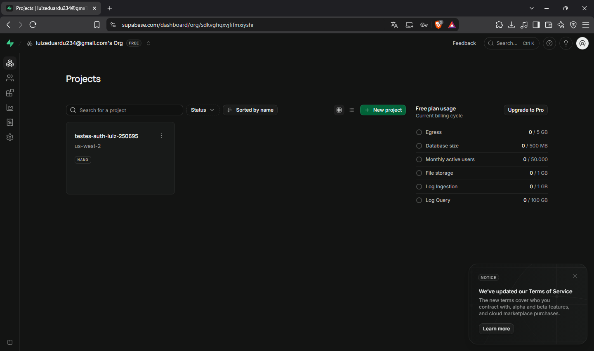

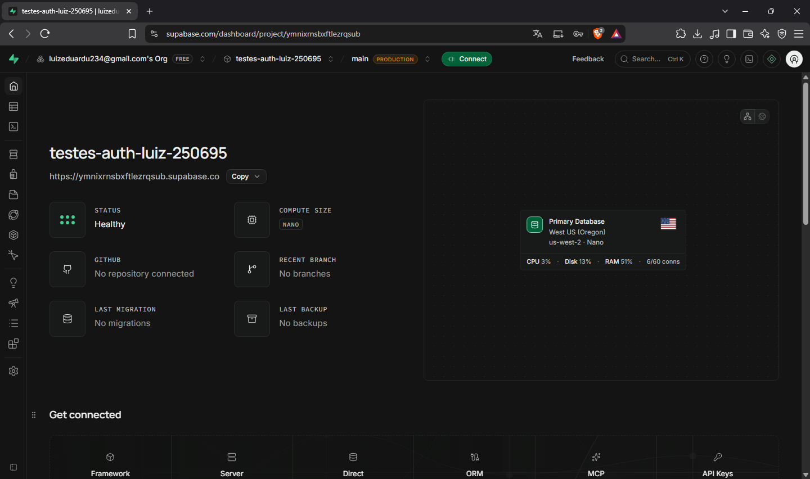

## Tipo de autenticação

Foi utilizada a autenticação por **e-mail e senha** (provider **Email**), em **Authentication → Sign In / Providers → Email**. Esse provider vem habilitado por padrão e permite que o usuário obtenha um token de acesso informando apenas e-mail e senha, exatamente o fluxo testado nesta atividade.

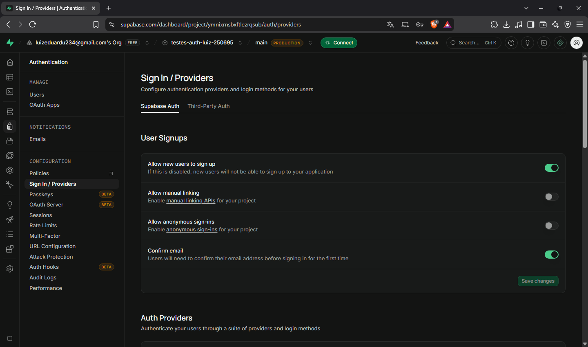

## Criação do usuário de teste

Em **Authentication → Users → Add user → Create new user**, foi criado o usuário de teste **`luiz.teste250695@gmail.com`**, com a opção **Auto Confirm User** marcada. Sem essa confirmação, o login retornaria o erro `email_not_confirmed` e o cenário de login válido não poderia ser executado.

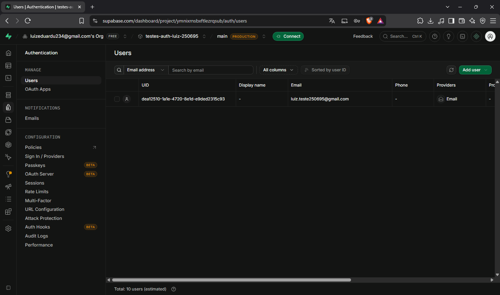

## Credenciais da API

Para os testes foram obtidas duas informações do projeto:

| Informação | Onde foi obtida | Uso nos testes |
|---|---|---|
| **API URL** | Integrations → Data API → **API URL** | Variável `base_url`: `https://ymnixrnsbxftlezrqsub.supabase.co` |
| **API KEY** (chave `anon` `public`) | Project Settings → API Keys → **Legacy API Keys** | Variável `api_key`, enviada nos headers `apikey` e `Authorization` |

> A tela *Data API* exibe a URL com o sufixo `/rest/v1` (endereço do banco de dados). Para a autenticação, apenas o domínio do projeto deve ser usado, pois o serviço de login fica em `/auth/v1`. Esse detalhe causou um erro durante a configuração (ver [Erros encontrados](#erros-encontrados)).

> Foi utilizada apenas a chave **pública** (`anon` `public`), que é a chave pensada para clientes. A chave `service_role` (`secret`) dá acesso administrativo e **não** foi utilizada nem exposta. Nos prints, os valores das chaves foram ocultados.

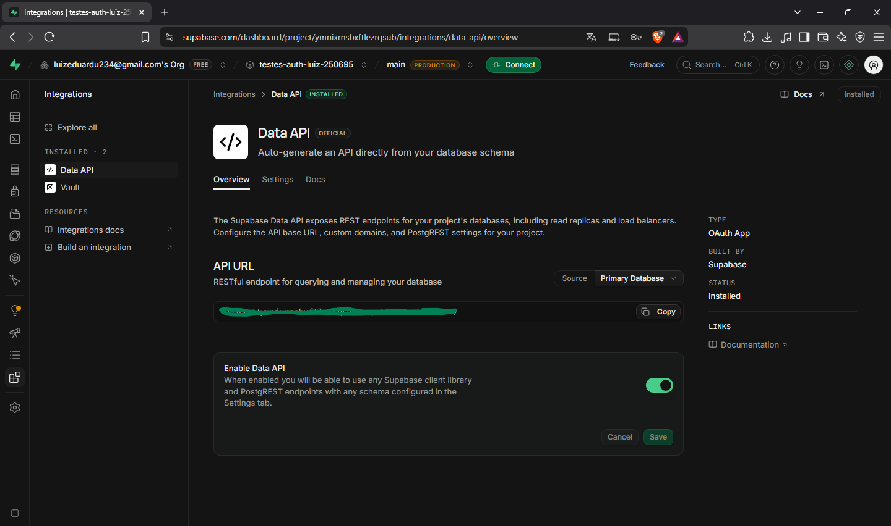

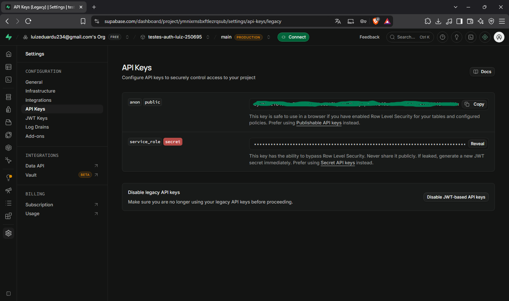

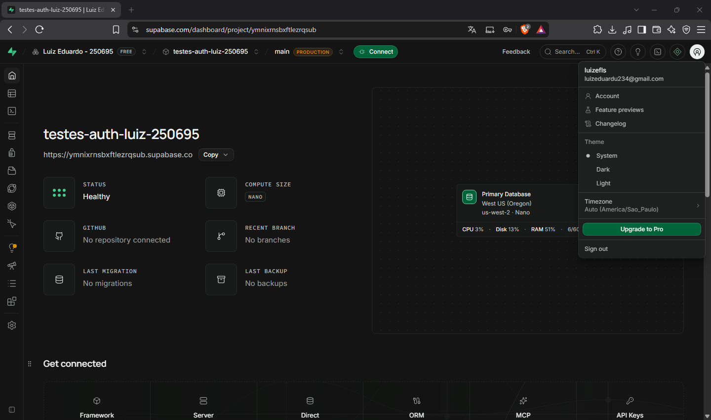

## Objetivo da configuração

A configuração do Supabase fornece um **servidor de autenticação real** (Supabase Auth / GoTrue) com um usuário conhecido. Assim, os testes partem de dados controlados: sabemos qual e-mail e senha são válidos e, portanto, conseguimos prever o resultado de cada cenário e comparar com o resultado obtido.

# Configuração do Postman

## Workspace

No Postman Desktop foi criado o workspace **UI-UX - Testes Supabase Auth** (Workspaces → Create Workspace), para manter as requisições desta atividade separadas de outros projetos.

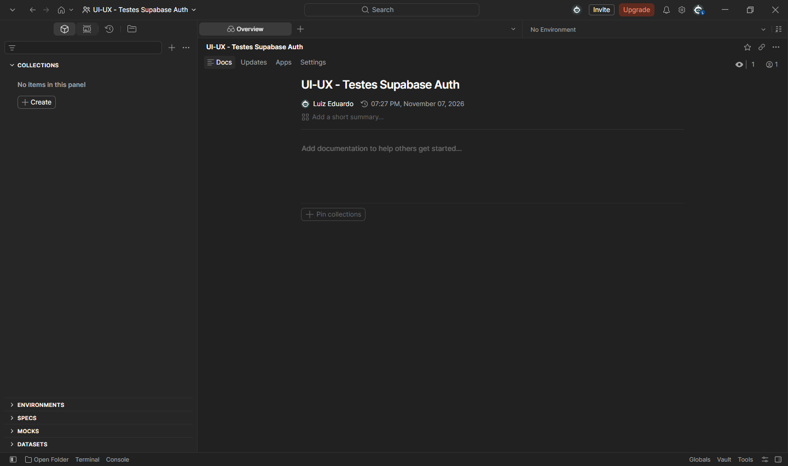

## Environment

Foi configurado o environment **Supabase Auth - Testes**, importado a partir do modelo [`postman/supabase-auth.postman_environment.json`](postman/supabase-auth.postman_environment.json) (Import → arrastar o arquivo). O modelo contém as variáveis com os valores em branco; os valores reais foram preenchidos apenas localmente, no Postman. Em seguida, o environment foi selecionado no seletor do canto superior direito, para que as variáveis fossem resolvidas nas requisições.

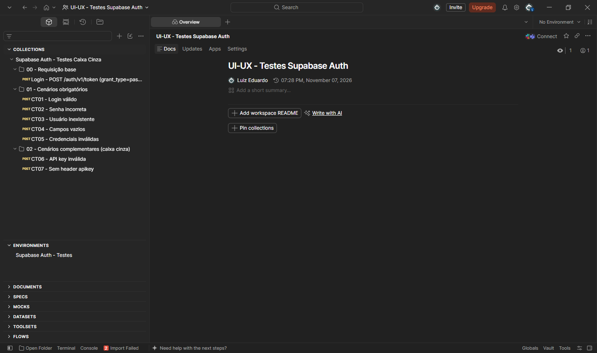

## Variáveis

| Variável | Descrição | Tipo |
|---|---|---|
| `base_url` | URL da API do Supabase (`https://ymnixrnsbxftlezrqsub.supabase.co`) | default |
| `api_key` | API KEY pública (`anon` `public`) do projeto | secret |
| `email` | E-mail do usuário criado no Supabase | default |
| `password` | Senha do usuário criado no Supabase | secret |

**Finalidade das variáveis:** centralizar os dados de configuração em um único lugar. As requisições usam `{{base_url}}`, `{{api_key}}`, `{{email}}` e `{{password}}`, então não é preciso repetir a URL e a chave em cada cenário, e trocar de projeto ou de usuário exige alterar apenas o environment. As variáveis sensíveis foram marcadas como **secret** para ficarem mascaradas na interface.

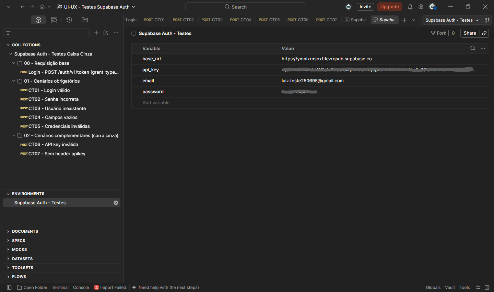

## Organização e uso do Postman

A collection [`postman/supabase-auth.postman_collection.json`](postman/supabase-auth.postman_collection.json) foi organizada em pastas:

| Pasta | Conteúdo |
|---|---|
| `00 - Requisição base` | Requisição obrigatória de login com as variáveis do environment |
| `01 - Cenários obrigatórios` | CT01 a CT05 (login válido, senha incorreta, usuário inexistente, campos vazios, credenciais inválidas) |
| `02 - Cenários complementares (caixa cinza)` | CT06 e CT07 (API key inválida e ausência do header `apikey`) |

Cada requisição possui **scripts de teste** (aba *Scripts → Post-response*) que validam automaticamente o status HTTP, o formato JSON da resposta, as mensagens de erro e a presença (ou ausência) do `access_token`. Os cenários foram executados individualmente e também em lote pelo **Collection Runner**.

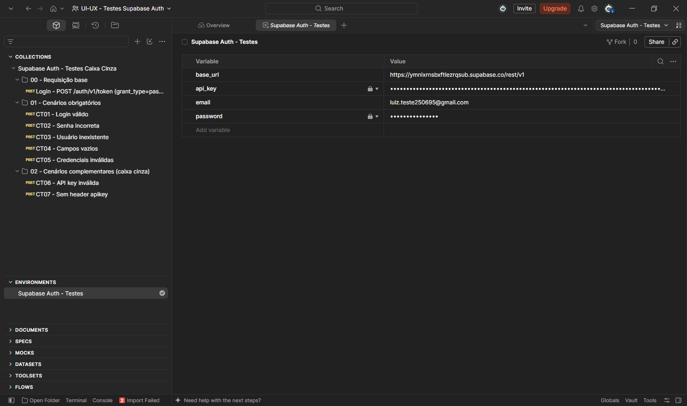

# Configuração das Requisições

## Endpoint e método

| Item | Valor |
|---|---|
| **Método HTTP** | `POST` |
| **Endpoint** | `/auth/v1/token?grant_type=password` |
| **URL completa no Postman** | `{{base_url}}/auth/v1/token?grant_type=password` |
| **Finalidade** | Autenticar um usuário por e-mail e senha e obter um `access_token` (JWT) |

O parâmetro `grant_type=password` informa ao Supabase Auth que o login será feito com e-mail e senha. Em caso de sucesso, a API devolve o `access_token`, que identifica o usuário autenticado nas demais requisições ao Supabase.

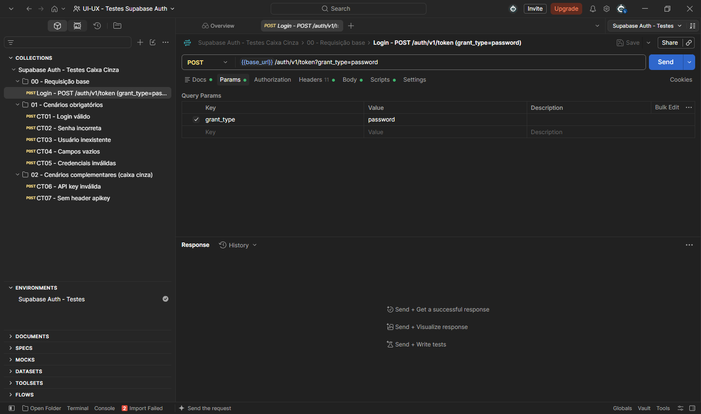

## Headers

**Exemplo de Header:**

| Header | Valor |
|---|---|
| `apikey` | `XXXXX` (variável `{{api_key}}`) |
| `Authorization` | `Bearer XXXXX` (`Bearer {{api_key}}`) |
| `Content-Type` | `application/json` |

- `apikey`: identifica o projeto Supabase para o gateway da API. Sem ele a requisição é bloqueada antes de chegar ao serviço de autenticação.
- `Authorization`: envia a mesma chave no formato `Bearer`.
- `Content-Type`: informa que o corpo da requisição está em JSON.

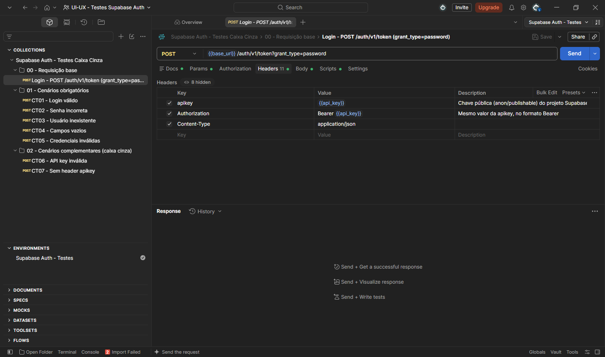

## Body JSON

**Exemplo do Body JSON:**

```json
{
  "email": "usuario@email.com",
  "password": "123456"
}
```

No Postman, o body foi configurado como **raw → JSON** usando as variáveis do environment:

```json
{
  "email": "{{email}}",
  "password": "{{password}}"
}
```

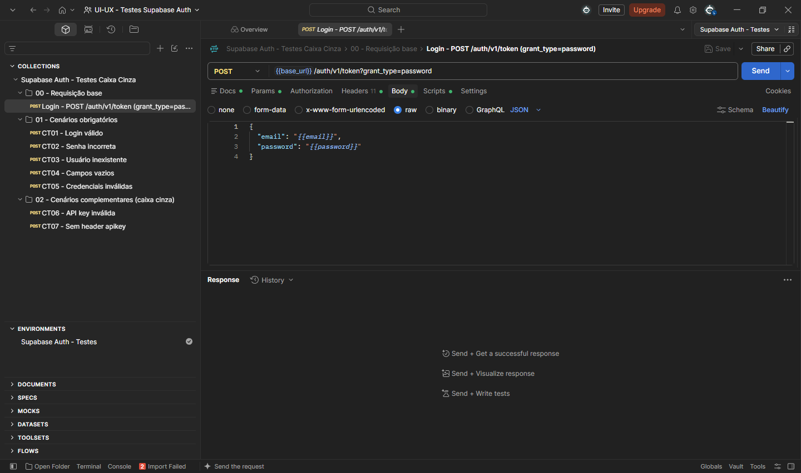

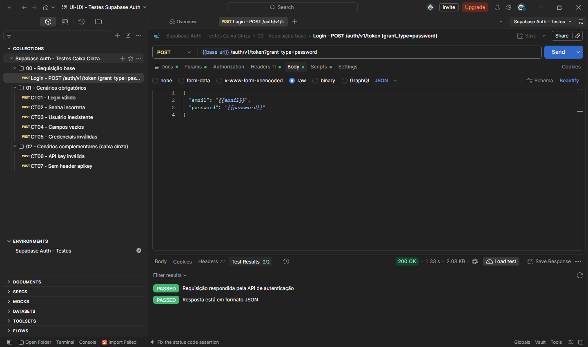

## Resposta esperada em caso de sucesso (resumida)

```json
{
  "access_token": "eyJhbGciOi...",
  "token_type": "bearer",
  "expires_in": 3600,
  "expires_at": 1767225600,
  "refresh_token": "xxxxxxxx",
  "user": {
    "id": "uuid-do-usuario",
    "email": "usuario@email.com",
    "role": "authenticated"
  }
}
```

# Execução dos Testes

## Cenários executados

Foram executados os **5 cenários obrigatórios** e **2 cenários complementares** de caixa cinza. Todos usam o mesmo endpoint e mudam apenas o body ou os headers:

| ID | Cenário | Entrada utilizada |
|---|---|---|
| CT01 | Login válido | `email`: usuário de teste; `password`: senha correta |
| CT02 | Senha incorreta | `email`: usuário de teste; `password`: `SenhaErrada@2026` |
| CT03 | Usuário inexistente | `email`: `usuario.inexistente.250695@teste.com`; `password`: senha do usuário de teste |
| CT04 | Campos vazios | `email`: `""`; `password`: `""` |
| CT05 | Credenciais inválidas | `email`: `email-invalido` (sem @); `password`: `123` |
| CT06 | API key inválida *(complementar)* | headers `apikey`/`Authorization` com `chave-invalida-teste`; credenciais corretas |
| CT07 | Sem header apikey *(complementar)* | sem os headers `apikey` e `Authorization`; credenciais corretas |

## O que foi validado em cada teste

| Validação | Como foi verificada (scripts do Postman) |
|---|---|
| Status HTTP | `pm.response.to.have.status(...)` |
| Resposta JSON | o corpo é convertido com `pm.response.json()` e deve ser um objeto |
| Mensagens de erro | campos `msg` / `error_description` / `message` não podem estar vazios e devem conter o texto esperado |
| Access token | no CT01 deve existir, ser um JWT de 3 partes e ter `role: authenticated`; nos demais cenários **não** pode existir |
| Comportamento da autenticação | CT03 compara a mensagem com a do CT02 para verificar se a API revela ou não a existência do e-mail |

## Tabela de Cenários

Testes executados em 07/11/2026 no Postman Desktop, com o environment **Supabase Auth - Testes**.

| Cenário | Entrada utilizada | Resultado esperado | Resultado obtido | Status |
|---|---|---|---|---|
| Login válido | Usuário e senha corretos | Status 200 + `access_token` | `200 OK` com `access_token` (JWT), `token_type: bearer`, `expires_in: 3600`, `refresh_token` e dados do usuário | ✅ OK |
| Senha incorreta | Usuário correto + senha errada | Erro de autenticação (400) | `400 Bad Request`: `invalid_credentials`, "Invalid login credentials" | ✅ OK |
| Usuário inexistente | E-mail não cadastrado | Acesso negado (400) | `400 Bad Request`: `invalid_credentials`, "Invalid login credentials" | ✅ OK |
| Campos vazios | `email` e `password` vazios | Erro de validação (400) | `400 Bad Request`: `validation_failed`, "missing email or phone" | ✅ OK |
| Credenciais inválidas | E-mail sem @ + senha `123` | Mensagem de erro (400) | `400 Bad Request`: `invalid_credentials`, "Invalid login credentials" | ✅ OK |
| API key inválida | `apikey` inválida | Status 401 | `401 Unauthorized`: "Invalid API key" | ✅ OK |
| Sem header apikey | Sem `apikey`/`Authorization` | Status 401 | `401 Unauthorized`: "No API key found in request" | ✅ OK |

## Evidências

### Testes válidos — CT01 Login válido (status 200, JSON e access token)

O `access_token` foi parcialmente ocultado no print por ser uma credencial de acesso.

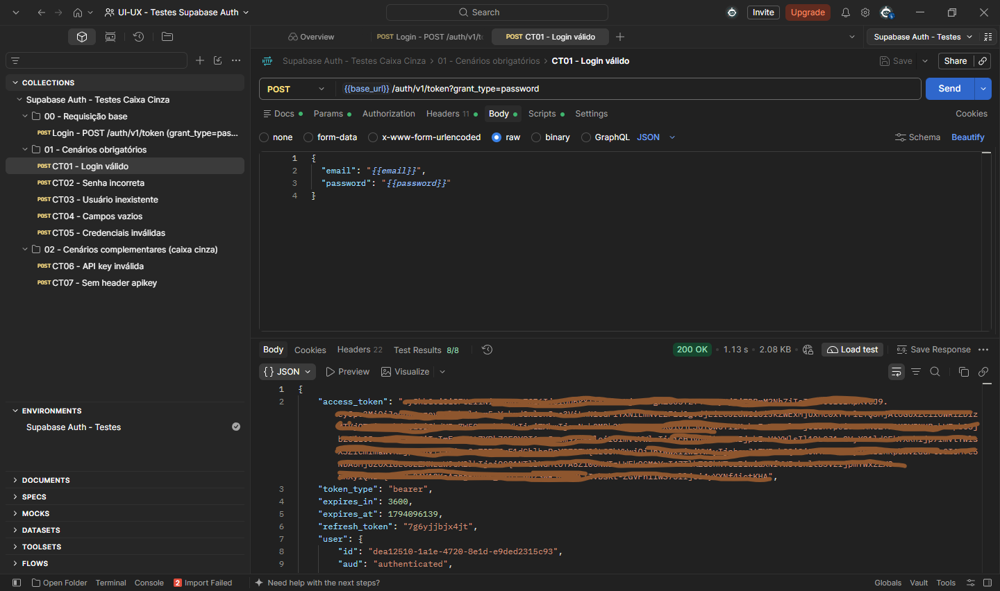

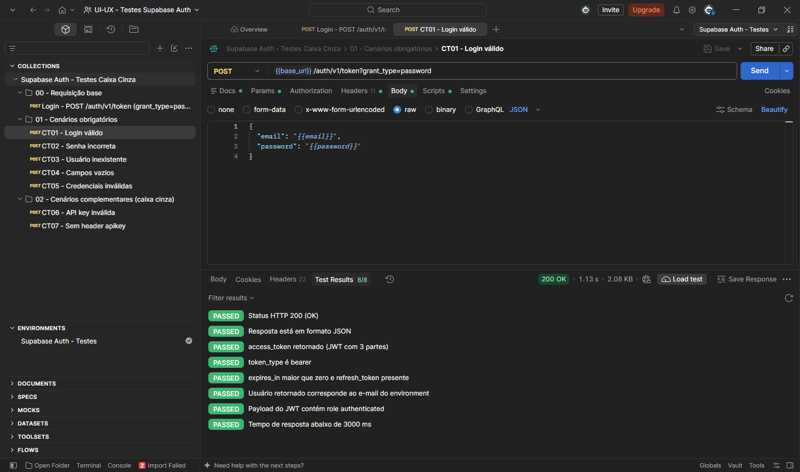

### Testes inválidos — status HTTP, respostas JSON e mensagens de erro

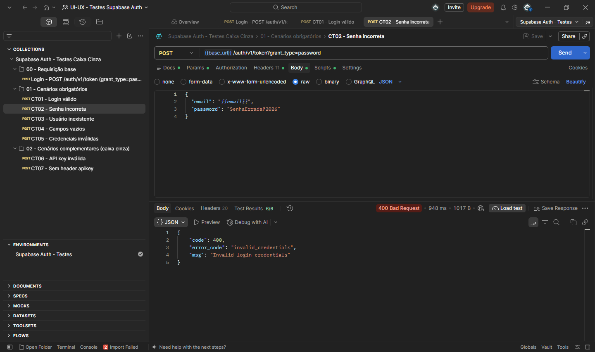

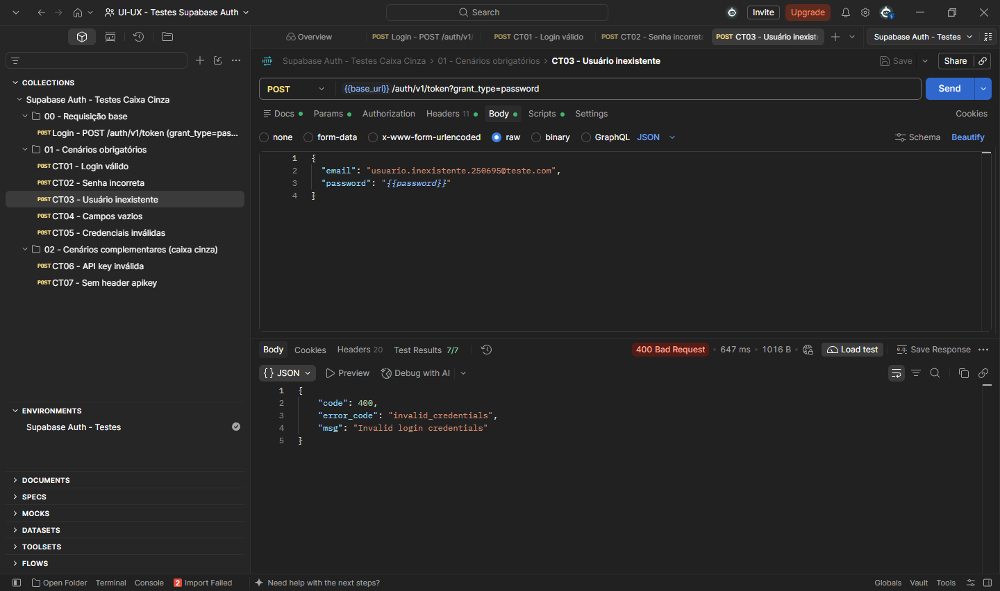

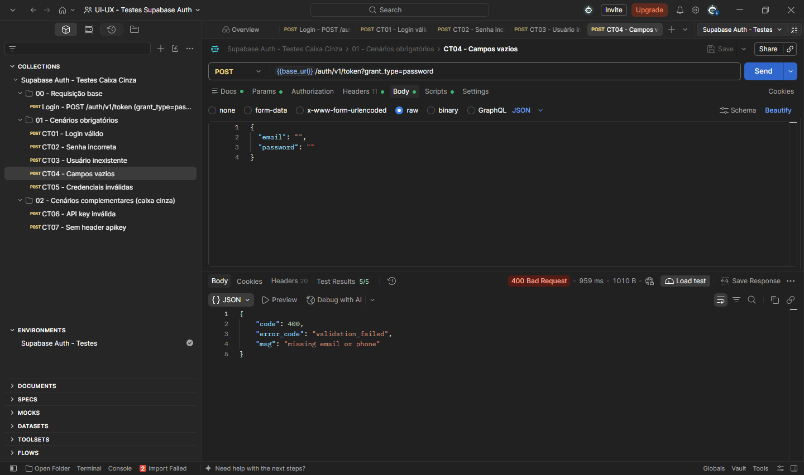

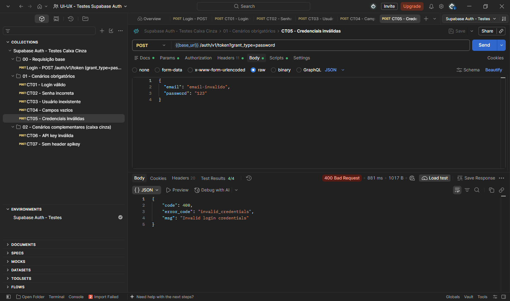

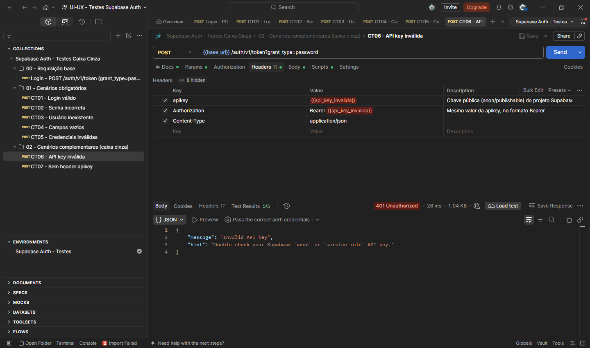

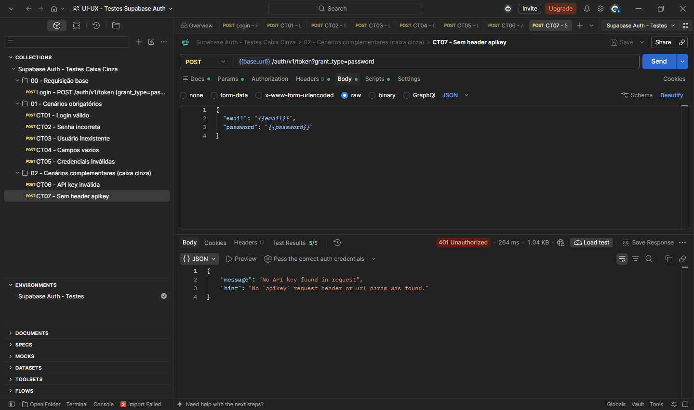

### Execução completa pelo Collection Runner

A collection inteira (requisição base + CT01 a CT07) foi executada pelo Collection Runner: **42 testes, 42 aprovados, 0 falhas, 0 erros**, duração total de 4,286 s e tempo médio de resposta de 411 ms.

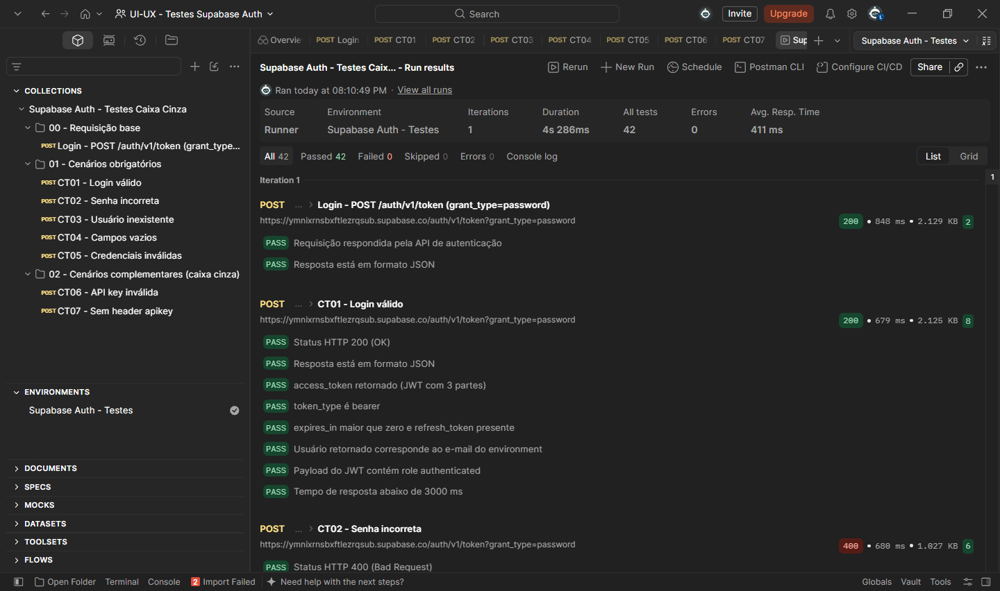

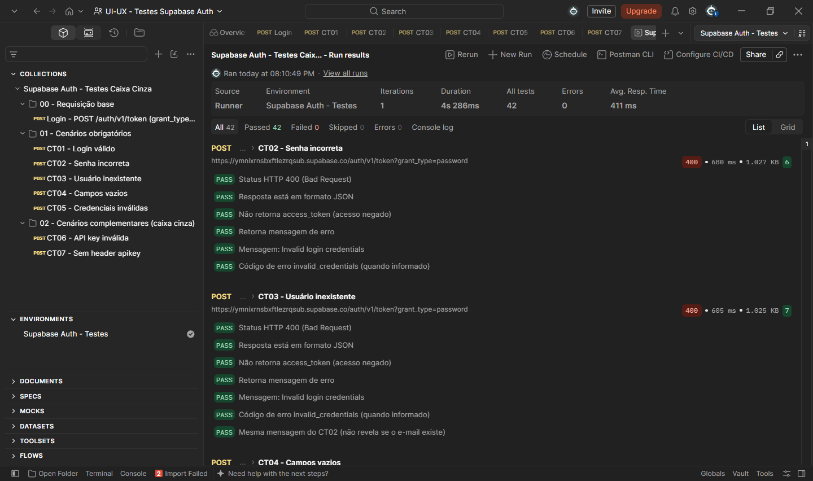

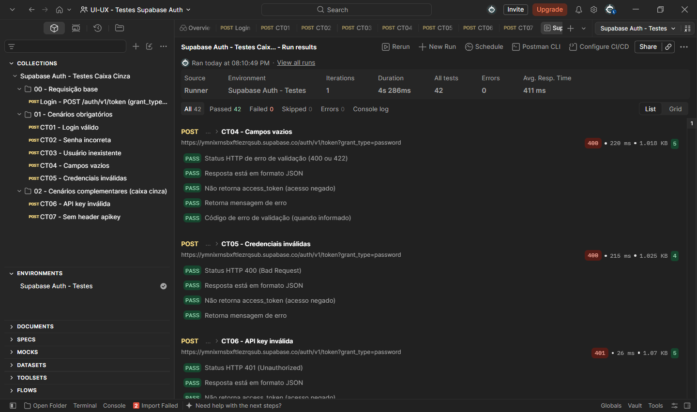

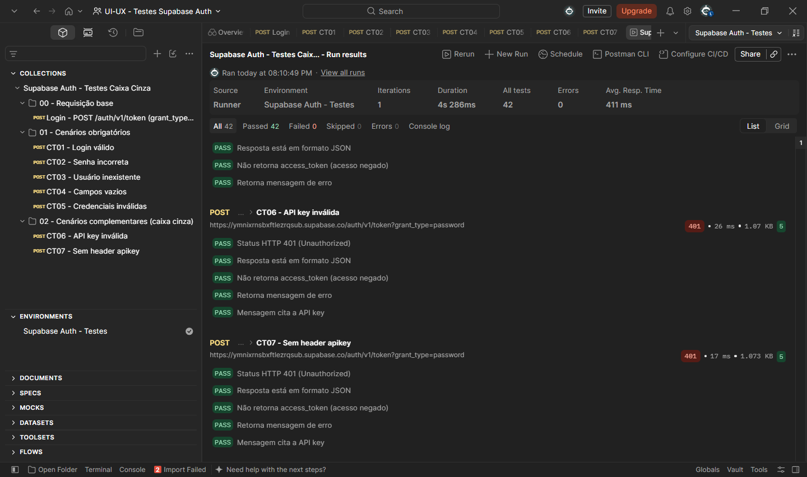

## Erros encontrados

Nenhum cenário de teste apresentou resultado diferente do esperado. Durante a **configuração** do ambiente, porém, ocorreram três erros, que foram analisados e corrigidos antes da execução final:

| # | Erro | Causa identificada | Correção |
|---|---|---|---|
| 1 | Ao importar a collection, o Postman pediu a chave do **Vault** e a importação falhou | O verificador de segredos do Postman interpretou o header de teste `Bearer chave-invalida-teste` (CT06) como um token real | A chave inválida do CT06 passou a ser definida por um script *Pre-request* (`{{api_key_invalida}}`), e a collection foi importada novamente |
| 2 | `401 Unauthorized` — "Invalid API key" na requisição base | O valor da variável `api_key` não estava sendo enviado corretamente (variável do tipo *secret* com o Vault bloqueado) | A chave `anon` `public` foi cadastrada novamente na variável e o environment foi salvo |
| 3 | `404 Not Found` — `PGRST125` "Invalid path specified in request URL" | O `base_url` foi copiado da tela *Data API* com o sufixo `/rest/v1`, e a requisição foi enviada ao PostgREST (banco de dados) em vez do serviço de autenticação | O `base_url` foi ajustado para conter apenas o domínio `https://ymnixrnsbxftlezrqsub.supabase.co` |

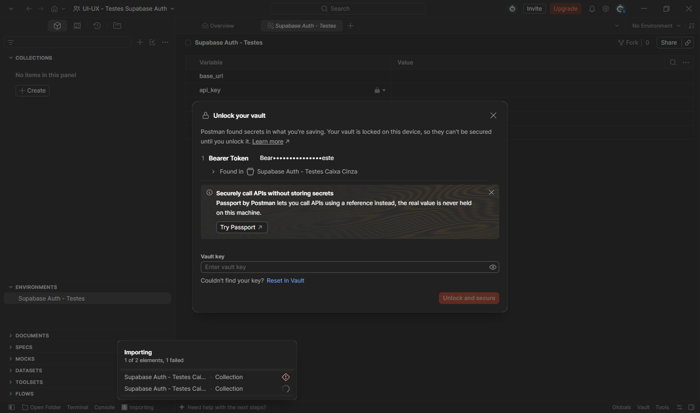

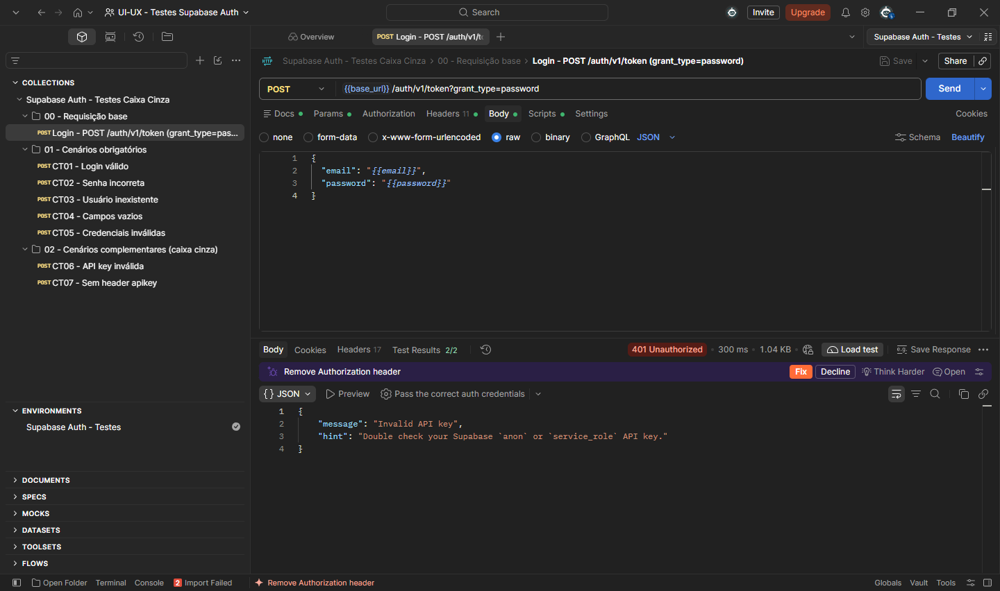

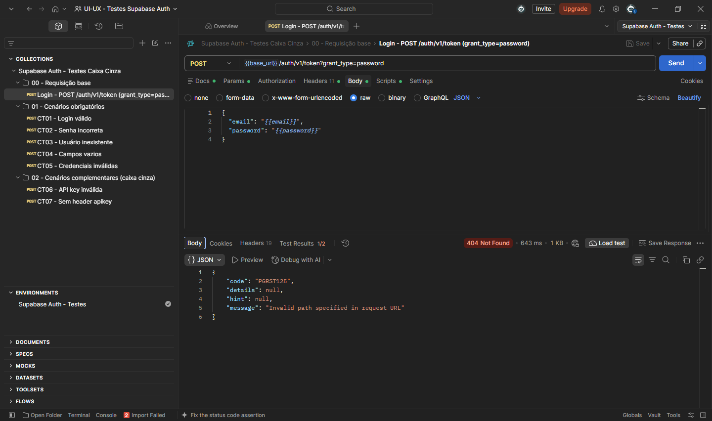

O erro 3 é um bom exemplo de diagnóstico de caixa cinza: o código `PGRST125` indica que a resposta veio do PostgREST, e não do Supabase Auth, o que revelou que o problema estava no caminho da URL e não nas credenciais.

# Registro dos Testes

## Como os testes foram registrados

Cada cenário foi registrado na planilha [`planilha/planilha-testes.xlsx`](planilha/planilha-testes.xlsx), aba **Testes**, com os campos:

| Campo | Descrição |
|---|---|
| ID do teste | Identificação (CT01 a CT07) |
| Cenário | Descrição do cenário |
| Entrada | Dados enviados no body ou nos headers |
| Resultado esperado | Resultado correto previsto antes da execução |
| Resultado obtido | Status HTTP e mensagem realmente retornados pela API |
| Status | Sucesso / Falha |
| Observações | Comentários sobre o comportamento observado |

O resultado esperado foi definido **antes** da execução; o resultado obtido e o status foram preenchidos **depois**, com base na resposta exibida no Postman. A aba **Resumo** calcula automaticamente o total de testes, quantos tiveram sucesso, quantos falharam e a taxa de sucesso.

## Exemplos dos registros realizados

| ID do teste | Cenário | Entrada | Resultado esperado | Resultado obtido | Status | Observações |
|---|---|---|---|---|---|---|
| CT01 | Login válido | Usuário e senha corretos | 200 + `access_token` | 200 OK, `access_token` JWT, `token_type: bearer`, `expires_in: 3600` | Sucesso | 8/8 testes aprovados; JWT com `role: authenticated` |
| CT03 | Usuário inexistente | `usuario.inexistente.250695@teste.com` | 400 + `Invalid login credentials` | 400, `invalid_credentials`, "Invalid login credentials" | Sucesso | Mesma mensagem do CT02: a API não revela se o e-mail existe |
| CT04 | Campos vazios | `email` e `password` vazios | 400 + erro de validação | 400, `validation_failed`, "missing email or phone" | Sucesso | A validação dos campos ocorre antes da verificação das credenciais |

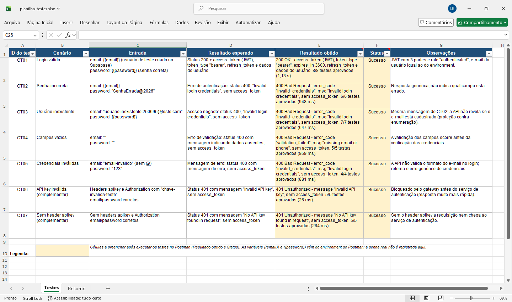

## Importância da documentação dos testes

Registrar os testes torna o processo **rastreável e reproduzível**: qualquer pessoa consegue repetir o mesmo cenário com a mesma entrada e comparar o resultado. A comparação entre resultado esperado e obtido deixa claro quando há um defeito, e o histórico ajuda a verificar se uma correção futura não quebrou o que já funcionava (teste de regressão).

## Falhas identificadas

Nenhuma falha foi identificada na API: os 7 cenários retornaram exatamente o comportamento esperado. Os problemas encontrados foram de **configuração do ambiente de testes** (Vault do Postman, valor da `api_key` e sufixo `/rest/v1` no `base_url`) e estão detalhados em [Erros encontrados](#erros-encontrados).

Como ponto de atenção (não é uma falha), o CT05 mostrou que a API **não valida o formato do e-mail** no login: um valor sem `@` recebe a mesma resposta genérica de credenciais inválidas.

# Resultados Obtidos

| ID | Cenário | Status HTTP esperado | Status HTTP obtido | Mensagem / retorno obtido | Tempo de resposta | Testes do Postman | Status |
|---|---|---|---|---|---|---|---|
| CT01 | Login válido | 200 | **200 OK** | `access_token`, `token_type: bearer`, `expires_in: 3600`, `refresh_token`, `user` | 1,13 s | 8 / 8 | ✅ Sucesso |
| CT02 | Senha incorreta | 400 | **400 Bad Request** | `invalid_credentials` — "Invalid login credentials" | 948 ms | 6 / 6 | ✅ Sucesso |
| CT03 | Usuário inexistente | 400 | **400 Bad Request** | `invalid_credentials` — "Invalid login credentials" | 647 ms | 7 / 7 | ✅ Sucesso |
| CT04 | Campos vazios | 400 | **400 Bad Request** | `validation_failed` — "missing email or phone" | 959 ms | 5 / 5 | ✅ Sucesso |
| CT05 | Credenciais inválidas | 400 | **400 Bad Request** | `invalid_credentials` — "Invalid login credentials" | 881 ms | 4 / 4 | ✅ Sucesso |
| CT06 | API key inválida | 401 | **401 Unauthorized** | "Invalid API key" | 26 ms | 5 / 5 | ✅ Sucesso |
| CT07 | Sem header apikey | 401 | **401 Unauthorized** | "No API key found in request" | 264 ms | 5 / 5 | ✅ Sucesso |

**Resumo:** 7 de 7 cenários com resultado igual ao esperado (100%). No Collection Runner: 42 de 42 testes automatizados aprovados, 0 falhas.

**Análise dos resultados:**

- **Login válido:** a API retornou um `access_token` no formato JWT (3 partes), com `role: authenticated` no payload, validade de 3600 segundos (1 hora) e um `refresh_token` para renovar a sessão.
- **Proteção contra enumeração de usuários:** senha incorreta (CT02), usuário inexistente (CT03) e credenciais inválidas (CT05) retornaram **exatamente a mesma resposta**. Isso impede que um atacante descubra quais e-mails estão cadastrados testando o login.
- **Validação antes da autenticação:** com os campos vazios (CT04), a API respondeu com `validation_failed` em vez de `invalid_credentials`, mostrando que a entrada é validada antes de qualquer consulta ao usuário.
- **Camada de API key:** sem a chave ou com uma chave inválida (CT06 e CT07), a requisição foi barrada com `401` pelo gateway do Supabase, antes de chegar ao serviço de autenticação. Isso aparece no tempo de resposta do CT06 (26 ms), muito menor que o dos cenários processados pelo serviço de autenticação (cerca de 650 ms a 1,1 s).
- Em nenhum cenário de erro a API retornou `access_token`.

# Conclusão

**Execução dos testes:** todos os cenários foram executados corretamente: os 5 cenários obrigatórios e os 2 complementares, individualmente e pelo Collection Runner, que registrou 42 testes automatizados aprovados e nenhuma falha.

**Funcionamento da autenticação:** a autenticação do Supabase funcionou como esperado. O login com credenciais corretas retornou status 200 e um `access_token` válido, e todas as tentativas inválidas foram bloqueadas com mensagens de erro adequadas e sem emissão de token.

**Dificuldades encontradas:** as principais dificuldades ocorreram na configuração do ambiente, e não nos testes em si. O Postman bloqueou a primeira importação da collection por interpretar um valor de teste como segredo (Vault). A `api_key` não foi enviada corretamente na primeira tentativa (erro 401). E a URL copiada da tela *Data API* continha o sufixo `/rest/v1`, que direcionava a requisição ao banco de dados em vez do serviço de autenticação (erro 404 `PGRST125`). Ler os códigos de erro retornados foi o que permitiu identificar e corrigir cada problema.

**Falhas identificadas:** nenhuma falha foi identificada no comportamento da API de autenticação. Como ponto de atenção, a API não valida o formato do e-mail no login (CT05), apenas retorna a mensagem genérica de credenciais inválidas.

**Melhorias que poderiam ser implementadas:**

- Exigir senhas mais fortes e ativar a proteção contra senhas vazadas nas configurações de autenticação.
- Configurar limites de tentativas de login (rate limit) e CAPTCHA para reduzir ataques de força bruta.
- Ativar a autenticação em dois fatores (MFA) para os usuários.
- Validar o formato do e-mail no lado do cliente antes de enviar a requisição, evitando chamadas desnecessárias à API.
- Automatizar a execução da collection com o Newman em um pipeline de integração contínua.

**Importância dos testes de caixa cinza em APIs:** conhecer o endpoint, os headers, o formato do body e os códigos de resposta permitiu criar cenários direcionados, inclusive para pontos que um usuário comum não veria, como a ausência do header `apikey` ou a mensagem genérica que impede descobrir quais e-mails estão cadastrados. Esse conhecimento parcial também ajudou no diagnóstico dos erros de configuração, como o `PGRST125`, que indicou que a requisição estava indo para o serviço errado. Ao mesmo tempo, o teste continua sendo feito pelo lado de fora, como um cliente real da API, o que torna essa abordagem adequada para validar a segurança e o comportamento de serviços de autenticação.
